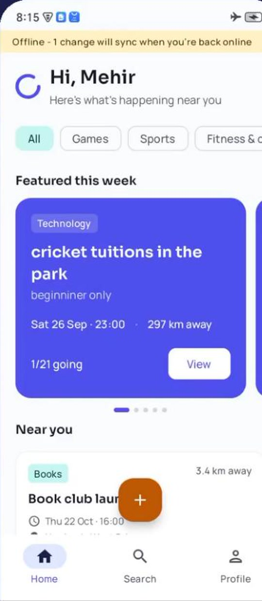
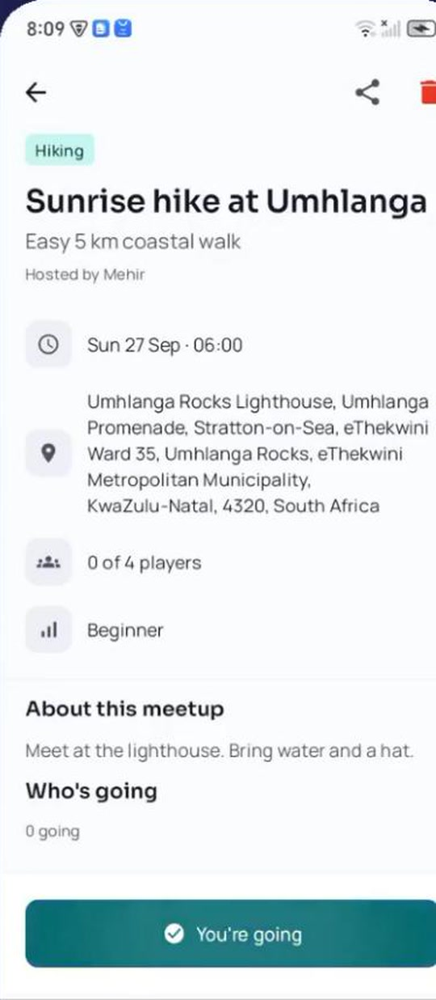
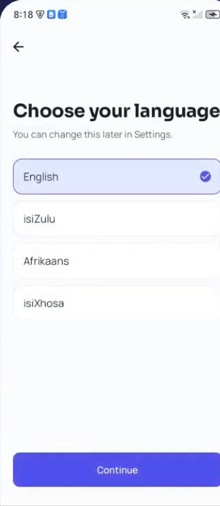
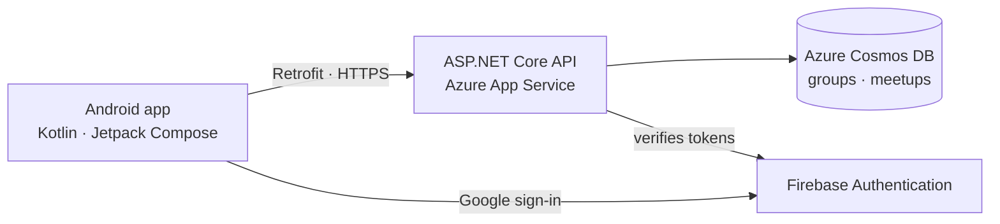
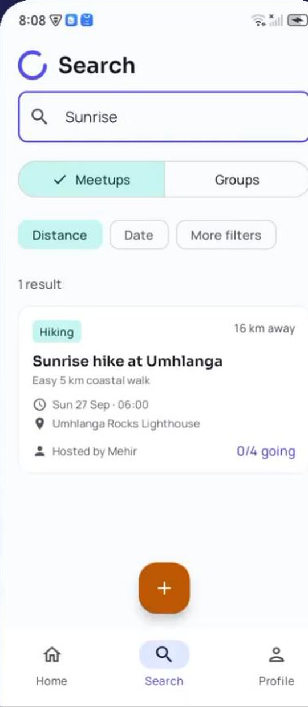
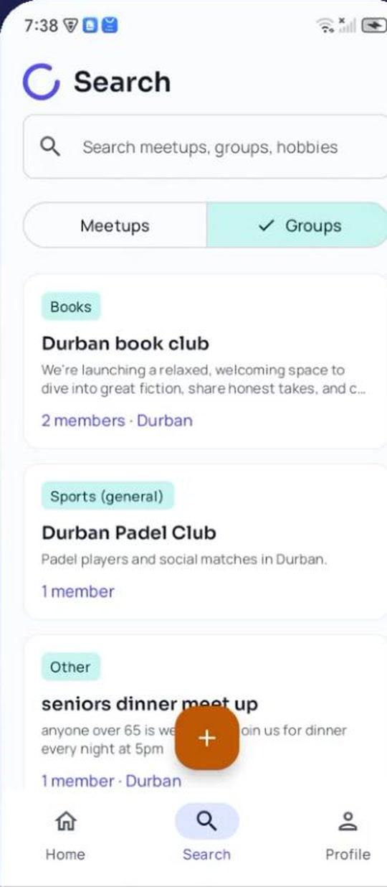
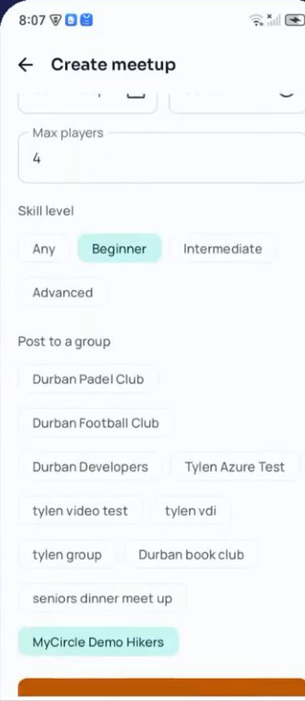
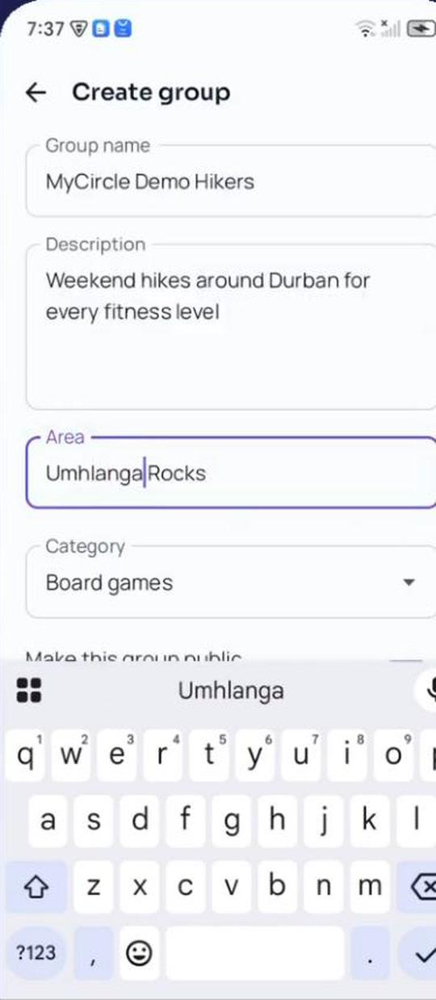

# MyCircle

A native Android app for finding local hobby groups and organising meetups. People discover a group, join it, then create or RSVP to meetups within it, from sunrise hikes to board-game nights.

Built by a team of four for our PROG7314 Portfolio of Evidence (2026). I was the UI developer. This repository is a showcase: screenshots, architecture and a summary of my part in it. The source is in a private repository and is **available on request**.

  
  
  

**Watch:** [demo video](https://youtu.be/yUldSx-1WgI)

## What it does

| Area | What a user can do |
|---|---|
| **Discover** | Browse a home feed of featured and nearby meetups, filtered by hobby, and search meetups and groups by name, distance and date. |
| **Groups** | Create a group with a category, area and photo, make it public or private, and join or leave groups. |
| **Meetups** | Create a meetup with a date, time, location, player limit and skill level, post it to a group, and RSVP. |
| **Sign-in** | Google sign-in, with optional fingerprint unlock. |
| **Languages** | Use the app in English, Afrikaans, isiZulu or isiXhosa. |
| **Settings** | Notification, fingerprint and offline preferences. |

## My role

I built the app's interface: 22 commits on my UI branch, which the team integrated into the main app. Most of it shipped as I wrote it (about 3,500 of 4,250 lines unchanged on `main`).

**Screens**
- Built 12 screens in Kotlin and Jetpack Compose: onboarding, language select, sign-in, biometric unlock, home feed, search, meetup detail, group detail, create meetup, create group, profile and settings.
- Built working search filters and the create forms, including Material 3 date and time pickers, a category dropdown and a photo picker.

**Navigation and design system**
- Built the navigation graph and the app shell (bottom navigation and the create button) and wired them into `MainActivity`.
- Applied the design from our planning document: the indigo, amber and teal palette, the Sora and Manrope typefaces, the type scale, the launcher icon and the shared components every screen uses.

**Built to hand over**
- Added a `MyCircleRepository` interface so screens never touch a data source directly, and passed screen data in as parameters. Teammates could then replace mock data with the live API without changing the UI.
- Aligned the repository with the agreed API contract, then routed every user action through it (RSVP, join, mute, settings, and both create forms, which send drafts matching the API's request bodies), with optimistic UI updates.

**Localisation and accessibility**
- Added English, Afrikaans, isiZulu and isiXhosa string resources.
- Exposed the date and time fields to accessibility services and stopped past dates being selectable.

## Architecture

- **App:** MVVM (screen → ViewModel → repository), Compose Navigation, Material 3. Device settings are stored on the device.
- **Backend:** ASP.NET Core REST API on Azure App Service, with Azure Cosmos DB storing groups, meetups, memberships and attendance.
- **CI:** GitHub Actions builds the app, runs its unit tests and runs the API's xUnit tests on every push.

**Stack:** Kotlin, Jetpack Compose, Material 3, Compose Navigation, MVVM, Retrofit, Firebase Authentication, ASP.NET Core, Azure Cosmos DB, Azure App Service, GitHub Actions.

## Screenshots

  
  
  
  

Screenshots are from the team's demo video, recorded on a teammate's phone against the live API.

## Team

Built by Ethan Kistan, Mehir Lallie, Isaac Narayanasami and Tylen Govender.

Work I did not do and want to credit: Mehir Lallie built the Google sign-in, fixed crashes found in live testing, handled DevOps and made the demo video. Isaac Narayanasami built the REST API and Cosmos DB backend. Tylen Govender built the Retrofit data layer, the settings functionality and the GitHub Actions CI.

## Source code

The code is private because it is coursework. If you would like to see it, contact me and I will give you access or walk you through it.

Ethan Kistan · ethankistan25@gmail.com · [ethankistan.github.io](https://ethankistan.github.io)
